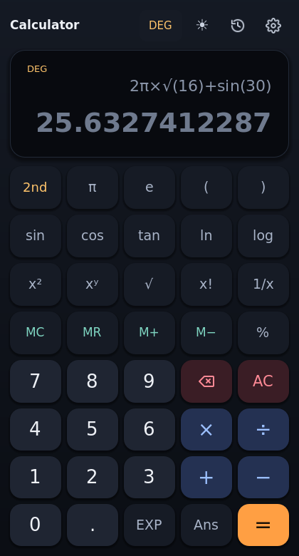
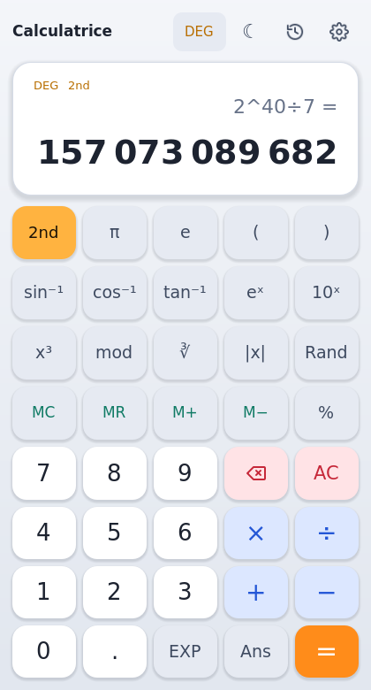
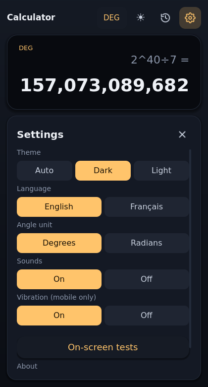

# Godot Calculator 🧮

**Calculatrice scientifique faite avec Godot 4 — Scientific calculator built with Godot 4.**


<p align="center">
  
  
  
</p>

🇫🇷 [Français](#-français) · 🇬🇧 [English](#-english)

---

## 🇫🇷 Français

Projet pour tester les fonctionnalités de Godot 4 (UI, thèmes, traductions,
entrées clavier, tweens, sauvegarde…) à travers une vraie application :
une calculatrice scientifique.

> ⚠️ **Version bêta** (`1.0.0-beta.2`) — objectif : une **v1.0** stable.
> Un bug ou une idée ? [Ouvrir une issue](../../issues/new/choose).

### Fonctionnalités

- Opérations de base `+ − × ÷`, parenthèses, priorité des opérateurs
- Fonctions scientifiques : `sin cos tan`, `sin⁻¹ cos⁻¹ tan⁻¹`, `ln log`, `eˣ 10ˣ`,
  `x² x³ xʸ`, `√ ∛`, `x!`, `|x|`, `1/x`, `mod`, `%`, notation scientifique `EXP`
- Constantes `π` et `e`, dernier résultat `Ans`, nombre aléatoire `Rand`
- Multiplication implicite : `2π`, `3(4+1)`, `2sin(30)`
- Degrés / radians (**DEG / RAD**)
- Touche **2nd** pour les fonctions secondes
- Mémoire **MC / MR / M+ / M−**
- **Aperçu du résultat en direct** pendant la saisie, séparateur de milliers
- **Saisie intelligente** : un opérateur remplace le précédent, une seule virgule par nombre, `)` seulement si une parenthèse est ouverte…
- **Historique** des calculs (cliquer sur une ligne pour la réutiliser)
- **Thème sombre / clair / automatique** (suit le thème du système)
- **Sons et vibrations** (désactivables)
- **Réglages** : thème, langue, unité d'angle, sons, vibration
- **Tests à l'écran** : la suite de tests tourne directement sur l'appareil (+ infos appareil)
- **Français et anglais** (virgule décimale et espace des milliers en français)
- Préférences, mémoire et historique **sauvegardés** automatiquement
- Compatible **pavé numérique** (même avec Verr. Num désactivé) et clavier complet
- **Android** : APK, icône adaptative, bouton retour, zones sûres (encoche)
- Interface adaptée au mobile (portrait) ; sur grand écran, l'historique s'affiche à côté du clavier

### Lancer le projet

1. Installer [Godot 4.3](https://godotengine.org/download) (ou plus récent, version standard, pas .NET).
2. Cloner le dépôt ou télécharger le ZIP :
   ```bash
   git clone https://github.com/AlexTheDevOnMicrobit/godot-calculator-app.git
   ```
3. Dans le gestionnaire de projets Godot : **Importer** → choisir `project.godot`.
4. Appuyer sur **F5** (▶ Lancer le projet).

### Raccourcis clavier

| Touche | Action |
|---|---|
| `0`–`9`, `.` ou `,` | Chiffres, virgule (pavé numérique compris) |
| `+ - * /` (ou `x`, `:`) | Opérations |
| `^` `(` `)` `!` `%` | Puissance, parenthèses, factorielle, pourcentage |
| `Entrée` / `Entrée` pavé num. / `=` | Calculer |
| `Retour arrière` | Effacer le dernier élément |
| `Échap` / `Suppr` | Tout effacer (AC) |
| `S` `C` `T` | sin, cos, tan |
| `L` `G` `R` | ln, log, racine carrée |
| `P` `E` `A` | π, e, Ans |
| `Tab` | 2nd |
| `H` | Afficher / masquer l'historique |
| `F2` | DEG / RAD |
| `F3` | Changer de langue |
| `F4` | Réglages |
| `F6` | Thème clair / sombre |
| `Ctrl+C` / `Ctrl+V` | Copier le résultat / coller une expression |

### Tests

```bash
godot --headless --path . --import
godot --headless --path . --script res://tests/test_runner.gd   # moteur de calcul
godot --headless --path . --script res://tests/test_ui.gd       # interface + clavier
```

Les tests tournent aussi automatiquement sur GitHub Actions.

Sur l'appareil : **Réglages → Tests à l'écran → Lancer les tests**.

### Android

- **Installer l'APK** : télécharger `GodotCalculator-…-debug.apk` (artefact `android-apk`
  du workflow **Build** sur GitHub Actions), puis l'ouvrir sur le téléphone
  (autoriser l'installation d'applications inconnues).
- **Exporter soi-même** : installer les modèles d'export Godot 4.3, le SDK Android
  et un JDK 17, renseigner leurs chemins dans **Éditeur → Paramètres de l'éditeur →
  Export → Android**, puis **Projet → Exporter… → Android**.

### Exporter

Des préréglages d'export sont fournis (Android, Windows, Linux, Web).
Installer d'abord les modèles d'export : **Éditeur → Gérer les modèles d'export**,
puis **Projet → Exporter…** Le workflow **Build** (lancement manuel ou tag `v*`)
produit automatiquement les 4 versions.

---

## 🇬🇧 English

A project to try out Godot 4 features (UI, themes, translations, keyboard
input, tweens, saving…) through a real app: a scientific calculator.

> ⚠️ **Beta version** (`1.0.0-beta.2`) — goal: a stable **v1.0**.
> Found a bug or have an idea? [Open an issue](../../issues/new/choose).

### Features

- Basic operations `+ − × ÷`, parentheses, operator precedence
- Scientific functions: `sin cos tan`, `sin⁻¹ cos⁻¹ tan⁻¹`, `ln log`, `eˣ 10ˣ`,
  `x² x³ xʸ`, `√ ∛`, `x!`, `|x|`, `1/x`, `mod`, `%`, scientific notation `EXP`
- Constants `π` and `e`, last answer `Ans`, random number `Rand`
- Implicit multiplication: `2π`, `3(4+1)`, `2sin(30)`
- Degrees / radians (**DEG / RAD**)
- **2nd** key for secondary functions
- Memory **MC / MR / M+ / M−**
- **Live result preview** while typing, thousands separators
- **Smart input**: an operator replaces the previous one, one decimal point per number, `)` only when a parenthesis is open…
- Calculation **history** (click a line to reuse it)
- **Dark / light / auto theme** (follows the system theme)
- **Sounds and vibration** (can be turned off)
- **Settings**: theme, language, angle unit, sounds, vibration
- **On-screen tests**: the test suite runs on the device itself (+ device info)
- **French and English** (decimal comma and thin-space grouping in French)
- Settings, memory and history **saved** automatically
- **Numeric keypad** (even with NumLock off) and full keyboard support
- **Android**: APK, adaptive icon, back button, safe areas (notches)
- Mobile-friendly (portrait); on wide screens the history is docked next to the keypad

### Running the project

1. Install [Godot 4.3](https://godotengine.org/download) (or newer, standard build, not .NET).
2. Clone the repository or download the ZIP:
   ```bash
   git clone https://github.com/AlexTheDevOnMicrobit/godot-calculator-app.git
   ```
3. In the Godot project manager: **Import** → select `project.godot`.
4. Press **F5** (▶ Run project).

### Keyboard shortcuts

| Key | Action |
|---|---|
| `0`–`9`, `.` or `,` | Digits, decimal point (numpad included) |
| `+ - * /` (or `x`, `:`) | Operators |
| `^` `(` `)` `!` `%` | Power, parentheses, factorial, percent |
| `Enter` / numpad `Enter` / `=` | Calculate |
| `Backspace` | Delete last item |
| `Esc` / `Delete` | Clear all (AC) |
| `S` `C` `T` | sin, cos, tan |
| `L` `G` `R` | ln, log, square root |
| `P` `E` `A` | π, e, Ans |
| `Tab` | 2nd |
| `H` | Show / hide history |
| `F2` | DEG / RAD |
| `F3` | Switch language |
| `F4` | Settings |
| `F6` | Light / dark theme |
| `Ctrl+C` / `Ctrl+V` | Copy result / paste an expression |

### Tests

```bash
godot --headless --path . --import
godot --headless --path . --script res://tests/test_runner.gd   # math engine
godot --headless --path . --script res://tests/test_ui.gd       # UI + keyboard
```

Tests also run automatically on GitHub Actions.

On the device: **Settings → On-screen tests → Run tests**.

### Android

- **Install the APK**: download `GodotCalculator-…-debug.apk` (the `android-apk`
  artifact of the **Build** workflow on GitHub Actions) and open it on the phone
  (allow installing unknown apps).
- **Export it yourself**: install the Godot 4.3 export templates, the Android SDK
  and a JDK 17, set their paths in **Editor → Editor Settings → Export → Android**,
  then **Project → Export… → Android**.

### Exporting

Export presets are included (Android, Windows, Linux, Web). Install the export
templates first: **Editor → Manage Export Templates**, then **Project → Export…**
The **Build** workflow (manual run or `v*` tag) produces all 4 builds automatically.

---

## 📁 Structure

```
godot-calculator-app/
├── project.godot                  # Project settings (window, theme, locales, Android back button)
├── icon.svg                       # App icon
├── export_presets.cfg             # Android / Windows / Linux / Web export presets
├── scenes/
│   └── main.tscn                  # Main screen (display, keypad, history / settings / tests panel)
├── scripts/
│   ├── main.gd                    # UI: keypad, keyboard/numpad, panels, themes, animations
│   ├── evaluator.gd               # Expression parser & math engine, number formatting
│   ├── expression_editor.gd       # Smart input rules (operators, decimals, parentheses)
│   ├── settings.gd                # Preferences, memory & history (user://settings.cfg)
│   ├── feedback.gd                # Sounds & haptics
│   └── self_test.gd               # Test suite shared by CI and the on-screen tests
├── assets/
│   ├── fonts/                     # DejaVu Sans (math symbol coverage) + license
│   ├── icons/                     # UI icons (SVG, tinted by the theme)
│   ├── sounds/                    # Click / result / error sounds (generated)
│   ├── android/                   # Launcher & adaptive icons
│   └── theme/                     # dark_theme.tres & light_theme.tres (generated)
├── translations/
│   └── translations.csv           # FR / EN strings (imported by Godot)
├── tools/                         # Generators: themes, sounds, Android icons
├── tests/
│   ├── test_runner.gd             # Unit tests (runs self_test.gd)
│   └── test_ui.gd                 # UI integration tests
├── docs/screenshots/
└── .github/                       # CI (tests, builds) + issue templates
```

### Regenerating assets

```bash
python3 tools/generate_themes.py                                  # themes (edit PALETTES)
python3 tools/generate_sounds.py                                  # sounds
godot --headless --path . --script res://tools/export_icons.gd    # Android icons
```

## 🗺️ Roadmap → v1.0

- [x] Scientific calculator core (beta.1)
- [x] FR / EN, numpad, history, memory (beta.1)
- [x] Beta feedback & bug fixes (beta.2)
- [x] Light theme / theme switch (beta.2)
- [x] Android export & on-screen tests (beta.2)
- [x] Sounds / haptics (beta.2)
- [x] Visual refresh (beta.2)
- [ ] Test the APK on several real phones / tablets
- [ ] Signed release APK / AAB for the Play Store
- [ ] v1.0 release

## 📄 License

Code: [Apache 2.0](LICENSE). Font: DejaVu Sans — see
[`assets/fonts/LICENSE-DejaVu.txt`](assets/fonts/LICENSE-DejaVu.txt).
