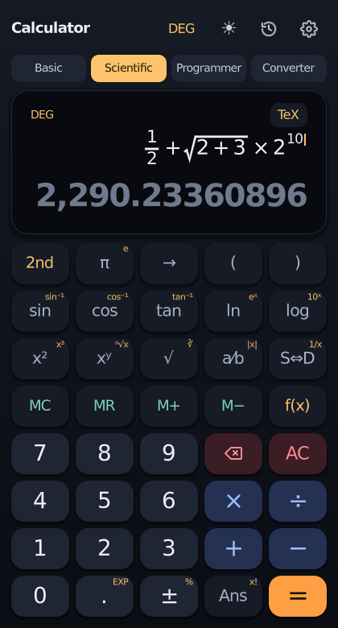
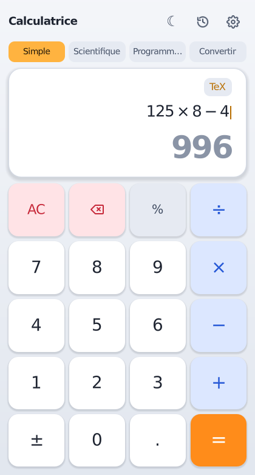
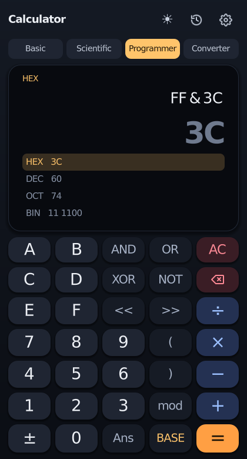
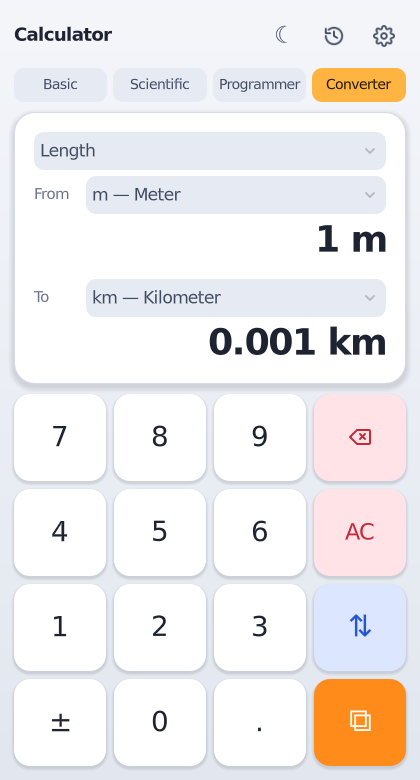

# Godot Calculator 🧮

**Calculatrice scientifique faite avec Godot 4 — Scientific calculator built with Godot 4.**


<p align="center">
  
  
  
  
</p>

🇫🇷 [Français](#-français) · 🇬🇧 [English](#-english)

---

## 🇫🇷 Français

Projet pour tester les fonctionnalités de Godot 4 (UI, thèmes, traductions,
dessin personnalisé, entrées clavier, tweens, sauvegarde, export Android…) à
travers une vraie application : une calculatrice.

> ⚠️ **Version bêta** (`1.0.0-beta.3`) — objectif : une **v1.0** stable.
> Un bug ou une idée ? [Ouvrir une issue](../../issues/new/choose).

### 4 modes

| Mode | Contenu |
|---|---|
| **Simple** | Le clavier de base : `+ − × ÷`, `%`, `±` |
| **Scientifique** | Trigo, logs, puissances, racines, fractions, mémoire, `2nd`, `f(x)` (toutes les fonctions), `S⇔D` |
| **Programmeur** | Entiers 64 bits, HEX / DEC / OCT / BIN affichés en même temps, `AND OR XOR NOT << >> mod` |
| **Convertir** | 11 catégories d'unités : longueur, masse, température, surface, volume, vitesse, temps, données, angle, énergie, pression |

### Affichage « comme dans le manuel »

- **Fractions** empilées, **racines** avec la barre au-dessus du radicande (et l'indice pour ⁿ√x),
  **exposants** en hauteur, parenthèses et valeurs absolues qui grandissent avec leur contenu.
- **Saisie intelligente des modèles** : `a⁄b`, `ⁿ√x`, `xʸ`, `log_b`, `nCr`… affichent des cases vides
  et un curseur ; la touche **→** (ou la flèche droite du clavier) passe à la case suivante.
- **S⇔D** : résultat en fraction (`15⁄4`) ou en décimal (`3,75`).
- **LaTeX** : bouton `TeX` (ou `Ctrl+Maj+C`) pour copier le calcul en LaTeX
  (`\frac{1}{2} + \sqrt{9} = 3.5`) ; **coller du LaTeX** (`Ctrl+V`) le calcule directement.

### Autres fonctionnalités

- Fonctions : `sin cos tan` et inverses, hyperboliques, `ln log log_b`, `eˣ 10ˣ`, `x² x³ xʸ`, `√ ∛ ⁿ√x`,
  `x!`, `nCr nPr`, `pgcd/gcd ppcm/lcm`, `|x|`, `round floor ceil`, `mod`, `%`, `Rand`, `RandInt`, `π e φ`, `Ans`
- Multiplication implicite (`2π`, `3(4+1)`, `2sin(30)`), degrés / radians, mémoire **MC / MR / M+ / M−**
- **Aperçu en direct**, séparateur de milliers, réglage du **nombre de décimales**
- **Historique** lisible (`³√27 + 3⁄4 = 3,75`), cliquer sur une ligne pour la reprendre
- **Thème sombre / clair / automatique**, **sons et vibrations**, **français / anglais**
- **Tests à l'écran** : la suite de tests (≈ 230 vérifications) tourne sur l'appareil
- **Pavé numérique** (même avec Verr. Num désactivé) et clavier complet
- **Android** : APK, icône adaptative, bouton retour, zones sûres (encoche)
- Sur grand écran, l'historique s'affiche à côté du clavier

### Lancer le projet

1. Installer [Godot 4.3](https://godotengine.org/download) (ou plus récent, version standard, pas .NET).
2. Cloner le dépôt ou télécharger le ZIP :
   ```bash
   git clone https://github.com/AlexTheDevOnMicrobit/godot-calculator-app.git
   ```
3. Dans le gestionnaire de projets Godot : **Importer** → choisir `project.godot`.
4. Appuyer sur **F5** (▶ Lancer le projet).

### Raccourcis clavier

| Touche | Action |
|---|---|
| `0`–`9`, `.` ou `,` | Chiffres, virgule (pavé numérique compris) |
| `+ - * /` (ou `x`, `:`) | Opérations |
| `^` `(` `)` `!` `%` | Puissance, parenthèses, factorielle, pourcentage |
| `F` | Fraction a⁄b |
| `→` (flèche droite) | Case suivante d'un modèle (fraction, racine, exposant…) |
| `Entrée` / `=` | Calculer (en mode Convertir : copier le résultat) |
| `Retour arrière` | Effacer le dernier élément |
| `Échap` / `Suppr` | Tout effacer (AC) |
| `S` `C` `T` `L` `G` `R` | sin, cos, tan, ln, log, racine carrée |
| `P` `E` `A` | π, e, Ans |
| `Tab` | 2nd |
| `H` | Historique |
| `Ctrl+1`…`Ctrl+4`, `F7` | Changer de mode |
| `F2` / `F3` / `F4` / `F6` | DEG/RAD · langue · réglages · thème |
| `Ctrl+C` / `Ctrl+Maj+C` / `Ctrl+V` | Copier le résultat / copier en LaTeX / coller (texte ou LaTeX) |
| Mode Programmeur : `a`–`f`, `& \| ~ < >` | Chiffres hexadécimaux, AND, OR, NOT, décalages |

### Tests

```bash
godot --headless --path . --import
godot --headless --path . --script res://tests/test_runner.gd   # moteur de calcul, LaTeX, programmeur, unités
godot --headless --path . --script res://tests/test_ui.gd       # interface, modes, clavier
```

Sur l'appareil : **Réglages → Tests à l'écran → Lancer les tests**. Les tests tournent aussi sur GitHub Actions.

### Android et exports

- **Installer l'APK** : télécharger `GodotCalculator-…-debug.apk` (artefact `android-apk` du workflow
  **Build** sur GitHub Actions), puis l'ouvrir sur le téléphone (autoriser les applications inconnues).
- **Exporter soi-même** : installer les modèles d'export Godot 4.3, le SDK Android et un JDK 17, renseigner
  leurs chemins dans **Éditeur → Paramètres de l'éditeur → Export → Android**, puis **Projet → Exporter…**
- Préréglages fournis : Android, Windows, Linux, Web. Le workflow **Build** (lancement manuel ou tag `v*`)
  produit les 4 versions.

---

## 🇬🇧 English

A project to try out Godot 4 features (UI, themes, translations, custom
drawing, keyboard input, tweens, saving, Android export…) through a real app:
a calculator.

> ⚠️ **Beta version** (`1.0.0-beta.3`) — goal: a stable **v1.0**.
> Found a bug or have an idea? [Open an issue](../../issues/new/choose).

### 4 modes

| Mode | What's inside |
|---|---|
| **Basic** | The essentials: `+ − × ÷`, `%`, `±` |
| **Scientific** | Trig, logs, powers, roots, fractions, memory, `2nd`, `f(x)` (all functions), `S⇔D` |
| **Programmer** | 64-bit integers, HEX / DEC / OCT / BIN shown together, `AND OR XOR NOT << >> mod` |
| **Converter** | 11 unit categories: length, mass, temperature, area, volume, speed, time, data, angle, energy, pressure |

### "Textbook" display

- Stacked **fractions**, **radicals** with a bar over the radicand (and the index for ⁿ√x),
  raised **exponents**, parentheses and absolute value bars that grow with their content.
- **Smart templates**: `a⁄b`, `ⁿ√x`, `xʸ`, `log_b`, `nCr`… show empty slots and a caret;
  the **→** key (or the Right arrow) moves to the next slot.
- **S⇔D**: result as a fraction (`15⁄4`) or a decimal (`3.75`).
- **LaTeX**: the `TeX` button (or `Ctrl+Shift+C`) copies the calculation as LaTeX
  (`\frac{1}{2} + \sqrt{9} = 3.5`); **pasting LaTeX** (`Ctrl+V`) computes it.

### More features

- Functions: `sin cos tan` and inverses, hyperbolic, `ln log log_b`, `eˣ 10ˣ`, `x² x³ xʸ`, `√ ∛ ⁿ√x`,
  `x!`, `nCr nPr`, `gcd lcm`, `|x|`, `round floor ceil`, `mod`, `%`, `Rand`, `RandInt`, `π e φ`, `Ans`
- Implicit multiplication (`2π`, `3(4+1)`, `2sin(30)`), degrees / radians, memory **MC / MR / M+ / M−**
- **Live preview**, thousands separators, **decimal places** setting
- Readable **history** (`³√27 + 3⁄4 = 3.75`), click a line to reuse it
- **Dark / light / auto theme**, **sounds and vibration**, **French / English**
- **On-screen tests**: the test suite (≈ 230 checks) runs on the device
- **Numeric keypad** (even with NumLock off) and full keyboard support
- **Android**: APK, adaptive icon, back button, safe areas (notches)
- On wide screens the history is docked next to the keypad

### Running the project

1. Install [Godot 4.3](https://godotengine.org/download) (or newer, standard build, not .NET).
2. Clone the repository or download the ZIP:
   ```bash
   git clone https://github.com/AlexTheDevOnMicrobit/godot-calculator-app.git
   ```
3. In the Godot project manager: **Import** → select `project.godot`.
4. Press **F5** (▶ Run project).

### Keyboard shortcuts

| Key | Action |
|---|---|
| `0`–`9`, `.` or `,` | Digits, decimal point (numpad included) |
| `+ - * /` (or `x`, `:`) | Operators |
| `^` `(` `)` `!` `%` | Power, parentheses, factorial, percent |
| `F` | Fraction a⁄b |
| `→` (Right arrow) | Next slot of a template (fraction, root, exponent…) |
| `Enter` / `=` | Calculate (Converter mode: copy the result) |
| `Backspace` | Delete last item |
| `Esc` / `Delete` | Clear all (AC) |
| `S` `C` `T` `L` `G` `R` | sin, cos, tan, ln, log, square root |
| `P` `E` `A` | π, e, Ans |
| `Tab` | 2nd |
| `H` | History |
| `Ctrl+1`…`Ctrl+4`, `F7` | Switch mode |
| `F2` / `F3` / `F4` / `F6` | DEG/RAD · language · settings · theme |
| `Ctrl+C` / `Ctrl+Shift+C` / `Ctrl+V` | Copy result / copy as LaTeX / paste (text or LaTeX) |
| Programmer mode: `a`–`f`, `& \| ~ < >` | Hex digits, AND, OR, NOT, shifts |

### Tests

```bash
godot --headless --path . --import
godot --headless --path . --script res://tests/test_runner.gd   # math engine, LaTeX, programmer, units
godot --headless --path . --script res://tests/test_ui.gd       # UI, modes, keyboard
```

On the device: **Settings → On-screen tests → Run tests**. Tests also run on GitHub Actions.

### Android and exports

- **Install the APK**: download `GodotCalculator-…-debug.apk` (the `android-apk` artifact of the
  **Build** workflow on GitHub Actions) and open it on the phone (allow unknown apps).
- **Export it yourself**: install the Godot 4.3 export templates, the Android SDK and a JDK 17, set their
  paths in **Editor → Editor Settings → Export → Android**, then **Project → Export…**
- Presets included: Android, Windows, Linux, Web. The **Build** workflow (manual run or `v*` tag)
  produces all 4 builds.

---

## 📁 Structure

```
godot-calculator-app/
├── project.godot                  # Project settings (window, theme, locales, Android back button)
├── export_presets.cfg             # Android / Windows / Linux / Web export presets
├── scenes/main.tscn               # Main screen (mode bar, display, keypads, side panels)
├── scripts/
│   ├── main.gd                    # UI: modes, keypads, keyboard/numpad, panels, themes, animations
│   ├── keypads.gd                 # Keypad layouts of each mode + f(x) function catalog
│   ├── evaluator.gd               # Expression parser & math engine, number / fraction formatting
│   ├── expression_editor.gd       # Smart input: operators, decimals, templates, → slots, ±
│   ├── math_format.gd             # Expression ⇄ math tree ⇄ LaTeX, one-line history form
│   ├── math_view.gd               # Draws the math tree (fractions, radicals, exponents, caret)
│   ├── programmer_evaluator.gd    # 64-bit integer evaluator, bases, bitwise operators
│   ├── units.gd                   # Converter units (11 categories, FR / EN names)
│   ├── converter_view.gd          # Converter display
│   ├── settings.gd                # Preferences, memory, history (user://settings.cfg)
│   ├── feedback.gd                # Sounds & haptics
│   └── self_test.gd               # Test suite shared by CI and the on-screen tests
├── assets/                        # fonts (DejaVu, MSDF), icons, sounds, Android icons, themes
├── translations/translations.csv  # FR / EN strings
├── tools/                         # Generators: themes, sounds, Android icons
├── tests/                         # test_runner.gd (unit), test_ui.gd (integration)
├── docs/screenshots/
└── .github/                       # CI (tests, builds) + issue templates
```

### Regenerating assets

```bash
python3 tools/generate_themes.py                                  # themes (edit PALETTES)
python3 tools/generate_sounds.py                                  # sounds
godot --headless --path . --script res://tools/export_icons.gd    # Android icons
```

## 🗺️ Roadmap → v1.0

- [x] Scientific calculator core, FR / EN, numpad, history, memory (beta.1)
- [x] Light theme, settings, sounds / haptics, Android export, on-screen tests (beta.2)
- [x] Basic / Scientific / Programmer / Converter modes (beta.3)
- [x] Textbook display, smart templates, fractions, LaTeX copy / paste (beta.3)
- [ ] Test the APK on several real phones / tablets
- [ ] Complex numbers (a + bi), equation solver, graphs (ideas)
- [ ] Signed release APK / AAB for the Play Store
- [ ] v1.0 release

## 📄 License

Code: [Apache 2.0](LICENSE). Font: DejaVu Sans — see
[`assets/fonts/LICENSE-DejaVu.txt`](assets/fonts/LICENSE-DejaVu.txt).
