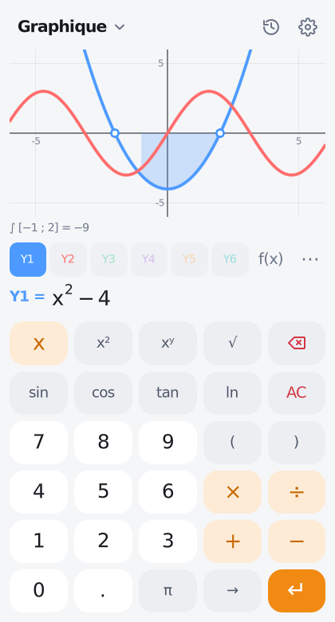
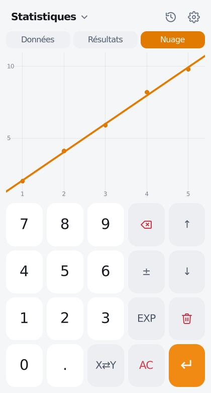
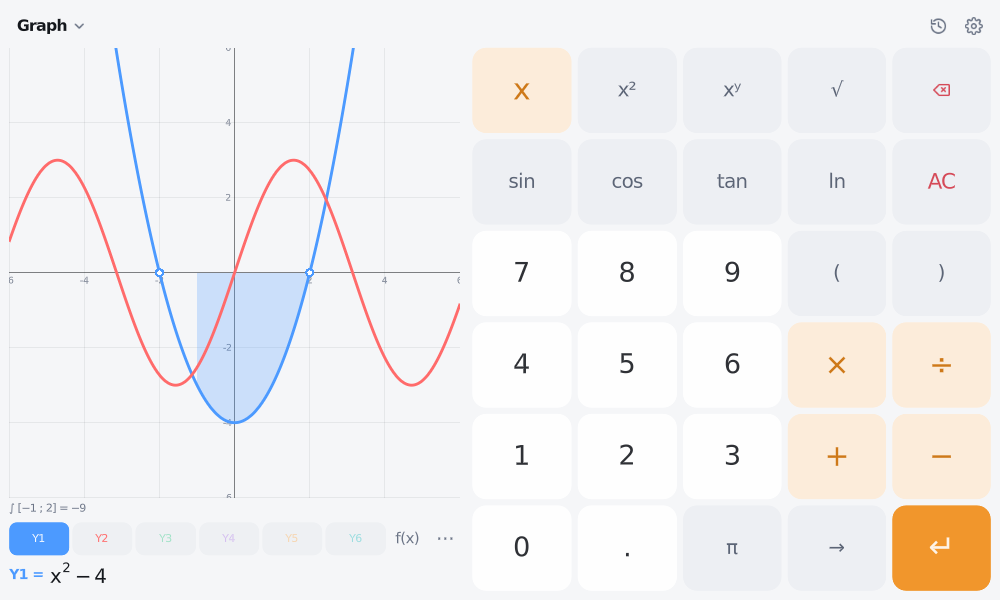

# Godot Calculator 🧮

**A minimal scientific calculator built with Godot 4 — Android, Web (PWA), Windows, macOS, Linux.**


<p align="center">
  
  
  
  
</p>
<p align="center">
  
</p>

🇬🇧 [English](#-english) · 🇫🇷 [Français](#-français)

> ⚠️ **Beta** (`1.0.0-beta.5`) — goal: a stable **v1.0**. Bugs or ideas: [open an issue](../../issues/new/choose).

---

## 🇬🇧 English

### What's inside

- **6 modes** — tap the mode name at the top left (or Ctrl+1…6): **Basic**, **Scientific**, **Graph**,
  **Statistics**, **Programmer** (HEX / DEC / OCT / BIN, AND OR XOR NOT, shifts) and **Converter**
  (11 unit categories).
- **Graphs** — up to 6 functions Y1…Y6, pan / pinch-zoom, trace (x, y, dy/dx), zeros, minimum,
  maximum, intersections, shaded integral, table of values, zoom standard / trig / fit.
- **Statistics** — data table X / Y, 1-Var and 2-Var stats (mean, Σ, σ, s, quartiles, r), regressions
  (linear, quadratic, exponential, power, logarithmic) with r², scatter plot and fitted curve.
- **Complex numbers** — `i` (2nd + π), results as `a + bi` or `r∠θ` (Settings), `conj`, `Re`, `Im`,
  `arg`, `abs`; like a TI-84, the "Real" setting reports non-real results as an error.
- **TI-84 functions** — `d/dx` (nDeriv), `∫` (fnInt), `Σ`, `Π`, `solve`, `fMin` / `fMax`,
  `normalpdf` / `normalcdf` / `invNorm`, `binompdf` / `binomcdf`, `poissonpdf` / `poissoncdf`,
  `randNorm`, `randBin`, `iPart`, `fPart`, `int`, `min`, `max`, `remainder`, Γ… (f(x) panel).
- **Textbook display** — real fractions, roots with a bar, exponents; templates (`a⁄b`, `√`, `xʸ`, `ⁿ√x`,
  `log_b`, `nCr`…) are filled box by box with **→**.
- **Results** — live preview, `⇄` fraction ⇄ decimal, `Ans`, history (clock icon).
- **Tap the display** to copy the result, copy it **as LaTeX**, or paste (LaTeX too).
- **f(x)** — every function, constants and the memory (M+ M− MR MC).
- **Settings** (gear icon) — theme (auto / light / dark), language, angle unit, decimal places,
  sounds, vibration, plus **Basic knowledge** (squares, primes, π, formulas…), **Help** and **on-screen tests**.
- **6 languages** — English, Français, Español, Deutsch, Italiano, Português.
- **Adapts to the screen** — portrait, landscape (display left, keypad right), wide screens (history docked),
  key labels scale with the key size, safe areas on phones with a notch.
- Full **keyboard and numeric keypad** support (shortcuts in Settings → Help).

### Run it

1. Install [Godot 4.3](https://godotengine.org/download) (standard build).
2. `git clone https://github.com/AlexTheDevOnMicrobit/godot-calculator-app.git` (or download the ZIP).
3. Godot project manager → **Import** → `project.godot` → **F5**.

### Get the apps

| Platform | How |
|---|---|
| **Android** | APK from the **Build** workflow (artifact `android-apk`) or a GitHub Release |
| **Web (PWA)** | **Pages** workflow → open the page, then "Install app" / "Add to home screen" |
| **Windows / Linux / macOS** | Build workflow artifacts or the GitHub Release (tags `v*`) |

Builds run on GitHub Actions: **Build** (manual or on a `v*` tag, creates a Release for tags) and
**Web app (GitHub Pages)** (enable *Settings → Pages → Source: GitHub Actions* once).

**Exporting locally**: install the Godot 4.3 export templates, create an empty `build/.gdignore`, then
`godot --headless --path . --export-release "<preset>" <path>`. Presets: `Android`, `Web`, `Windows Desktop`,
`Linux`, `macOS`. Android needs the Android SDK + JDK 17 (Editor Settings → Export → Android). The Windows
icon is embedded when `rcedit` is configured (Editor Settings → Export → Windows).

**Signed Android release**: add the secrets `ANDROID_KEYSTORE_BASE64`, `ANDROID_KEYSTORE_USER` and
`ANDROID_KEYSTORE_PASSWORD`; the Build workflow then also produces a signed release APK.

### Tests

```bash
godot --headless --path . --import
godot --headless --path . --script res://tests/test_runner.gd   # engine, LaTeX, units, translations…
godot --headless --path . --script res://tests/test_ui.gd       # UI, modes, layouts, languages
```

On a device: **Settings → On-screen tests**.

---

## 🇫🇷 Français

### Contenu

- **6 modes** — touchez le nom du mode en haut à gauche (ou Ctrl+1…6) : **Simple**, **Scientifique**,
  **Graphique**, **Statistiques**, **Programmeur** (HEX / DEC / OCT / BIN, AND OR XOR NOT, décalages) et
  **Convertisseur** (11 catégories d'unités).
- **Graphiques** — jusqu'à 6 fonctions Y1…Y6, déplacement / zoom à deux doigts, trace (x, y, dy/dx), zéros,
  minimum, maximum, intersections, intégrale hachurée, tableau de valeurs, zooms standard / trigo / ajusté.
- **Statistiques** — tableau X / Y, stats à 1 et 2 variables (moyenne, Σ, σ, s, quartiles, r), régressions
  (linéaire, quadratique, exponentielle, puissance, logarithmique) avec r², nuage de points et courbe.
- **Nombres complexes** — `i` (2nd + π), résultats en `a + bi` ou `r∠θ` (Réglages), `conj`, `Re`, `Im`,
  `arg`, `abs` ; comme une TI-84, le réglage « Réel » signale les résultats non réels.
- **Fonctions TI-84** — `d/dx` (nDeriv), `∫` (fnInt), `Σ`, `Π`, `solve`, `fMin` / `fMax`, lois normale,
  binomiale et de Poisson (`normalcdf`, `invNorm`, `binompdf`…), `randNorm`, `iPart`, `fPart`, Γ… (panneau f(x)).
- **Affichage comme dans un manuel** — vraies fractions, racines avec barre, exposants ; les modèles
  (`a⁄b`, `√`, `xʸ`, `ⁿ√x`, `log_b`, `nCr`…) se remplissent case par case avec **→**.
- **Résultats** — aperçu en direct, `⇄` fraction ⇄ décimal, `Ans`, historique (icône horloge).
- **Touchez l'affichage** pour copier le résultat, le copier **en LaTeX** ou coller (LaTeX aussi).
- **f(x)** — toutes les fonctions, les constantes et la mémoire (M+ M− MR MC).
- **Réglages** (icône engrenage) — thème (auto / clair / sombre), langue, unité d'angle, décimales,
  sons, vibration, ainsi que **Connaissances de base** (carrés, nombres premiers, π, formules…), **Aide** et
  **tests à l'écran**.
- **6 langues** — English, Français, Español, Deutsch, Italiano, Português.
- **S'adapte à l'écran** — portrait, paysage (affichage à gauche, clavier à droite), grands écrans
  (historique à côté), taille du texte des touches adaptée, zones sûres des téléphones à encoche.
- **Clavier et pavé numérique** complets (raccourcis dans Réglages → Aide).

### Lancer le projet

1. Installer [Godot 4.3](https://godotengine.org/download) (version standard).
2. `git clone https://github.com/AlexTheDevOnMicrobit/godot-calculator-app.git` (ou télécharger le ZIP).
3. Gestionnaire de projets Godot → **Importer** → `project.godot` → **F5**.

### Obtenir les applications

| Plateforme | Comment |
|---|---|
| **Android** | APK du workflow **Build** (artefact `android-apk`) ou d'une Release GitHub |
| **Web (PWA)** | Workflow **Pages** → ouvrir la page, puis « Installer l'application » / « Ajouter à l'écran d'accueil » |
| **Windows / Linux / macOS** | Artefacts du workflow Build ou Release GitHub (tags `v*`) |

Pour exporter soi-même, signer l'APK Android ou lancer les tests : voir la partie anglaise ci-dessus
(mêmes commandes).

---

## 📁 Structure

```
scenes/main.tscn            Main screen (top bar, display, keypads, side sheet)
scripts/
  main.gd                   UI: modes, layouts, menus, settings, help, keyboard
  keypads.gd                Keypad layouts + f(x) catalog
  evaluator.gd              Math engine (real + complex), calculus, probability, formatting
  stats.gd                  1-Var / 2-Var statistics, regressions
  graph_view.gd / graph_panel.gd   Graph drawing, gestures, analysis; Y= editor and tools
  stats_panel.gd            Statistics mode (data table, results, plot)
  expression_editor.gd      Smart input (templates, → slots, ±, operators)
  math_format.gd            Expression ⇄ math tree ⇄ LaTeX, one-line history form
  math_view.gd              Draws the math tree (fractions, radicals, caret)
  programmer_evaluator.gd   64-bit integers, bases, bitwise operators
  units.gd / converter_view.gd   Converter
  knowledge.gd / knowledge_view.gd   Basic knowledge page
  settings.gd · feedback.gd · self_test.gd
assets/                     Fonts (DejaVu, MSDF), icons, sounds, themes, app icons
translations/translations.csv   All texts, 6 languages (one column each)
tools/                      Generators: themes, sounds, icons, Windows .ico
tests/                      Unit + UI tests
.github/                    CI, builds, releases, GitHub Pages, issue templates
```

**Adding a language**: add a column to `translations/translations.csv`, list the new
`.translation` file in Project Settings → Localization, and add the code to `Settings.LANGUAGES`
(`scripts/settings.gd`). The *Translations* test reports any missing text.

**Regenerating assets**: `python3 tools/generate_themes.py`, `python3 tools/generate_sounds.py`,
`godot --headless --path . --script res://tools/export_icons.gd`, then `python3 tools/make_ico.py`.

## 🗺️ Roadmap → v1.0

- [x] beta.1 — calculator core, FR / EN, numpad, history, memory
- [x] beta.2 — themes, settings, sounds / haptics, Android, on-screen tests
- [x] beta.3 — modes, textbook display, templates, LaTeX, basic knowledge
- [x] beta.4 — minimal redesign, landscape & screen adaptation, 6 languages, all platforms, performance
- [x] beta.5 — complex numbers, graphs, statistics & regressions, TI-84 functions (calculus, probability)
- [ ] Test on real phones / tablets, collect feedback
- [ ] Store releases (Play Store AAB, signed desktop builds) and v1.0

## 📄 License

Code: [Apache 2.0](LICENSE). Font: DejaVu Sans — see [`assets/fonts/LICENSE-DejaVu.txt`](assets/fonts/LICENSE-DejaVu.txt).
